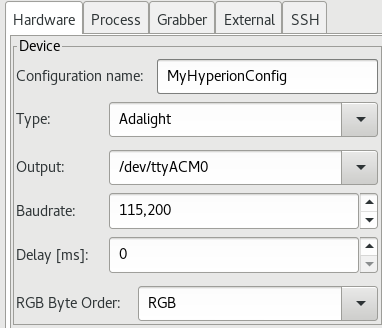
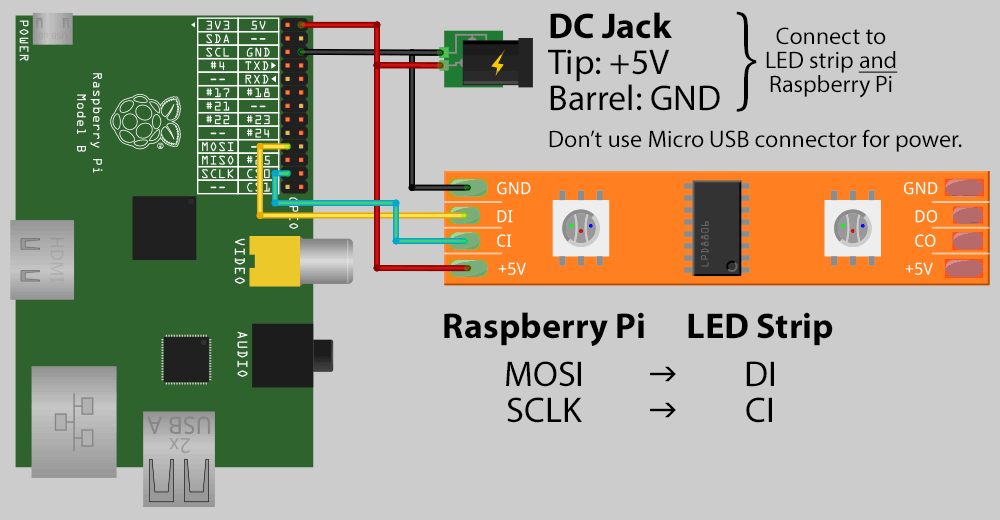

# Hyperion

WARNING: Hyperion does not support the GBM/V4L2 video pipeline used in LibreELEC 10.x and 11.x: including all Raspberry Pi and Generic x86\_64 (GBM) releases. Users with x86\_64 hardware can update to the Generic\_Legacy (X11) image. Users with Raspberry Pi hardware must use an external grabber hardware device or remain on older releases. Changes to add GBM support to Hyperion were proposed but did not reach a stable enough state to be added. The work was tracked in [hyperion-ng pull request #1422](https://github.com/hyperion-project/hyperion.ng/pull/1422)


[Hyperion](https://github.com/hyperion-project/hyperion.ng) is an open source project providing an ambient lighting system, compatible with Kodi.

Hyperion requires some hardware and software configuration. This page will describe the process of adding Hyperion to Generic x86\_64 and Raspberry Pi hardware.

For the software configuration, please head over to [Hypercon](hypercon.md). 

# Hardware
## Adalight

If you want hardware that will work on any LibreELEC device, an Adalight setup may be a good choice. It works by sending serial data to an Arduino micro controller which controls the LEDs. You need:

* Arduino (Uno, nano, etc)
* WS2801 LED strand
* 5V power supply
* Wire/Jumpers
* Breadboard/Protoboard (optional)
* Soldering iron (optional)

.png>)

Follow the tutorial here [https://learn.adafruit.com/adalight-diy-ambient-tv-lighting/overview](https://learn.adafruit.com/adalight-diy-ambient-tv-lighting/overview).

In [Hypercon](hypercon.md) you will need to enable:



## Raspberry Pi

Pi devices can drive an SPI output directly, and hyperion can output to an spidev device. You need:

* Raspberry Pi
* WS2801 LED strand
* 5V power supply
* Wire/Jumpers



You can find the pinout here [https://pinout.xyz](https://pinout.xyz). You will need to connect the following pins:

```
19 MOSI -> Data
23 SCLK -> Clock
25 GND  -> Ground
```

You need to enable SPI in the config.txt file:

```
mount -o remount,rw /flash
nano /flash/config.txt
```

Add the following line to the end of the file:

```
dtparam=spi=on
```

Then reboot. In [Hypercon](hypercon.md) you will need to enable:

.png>)
